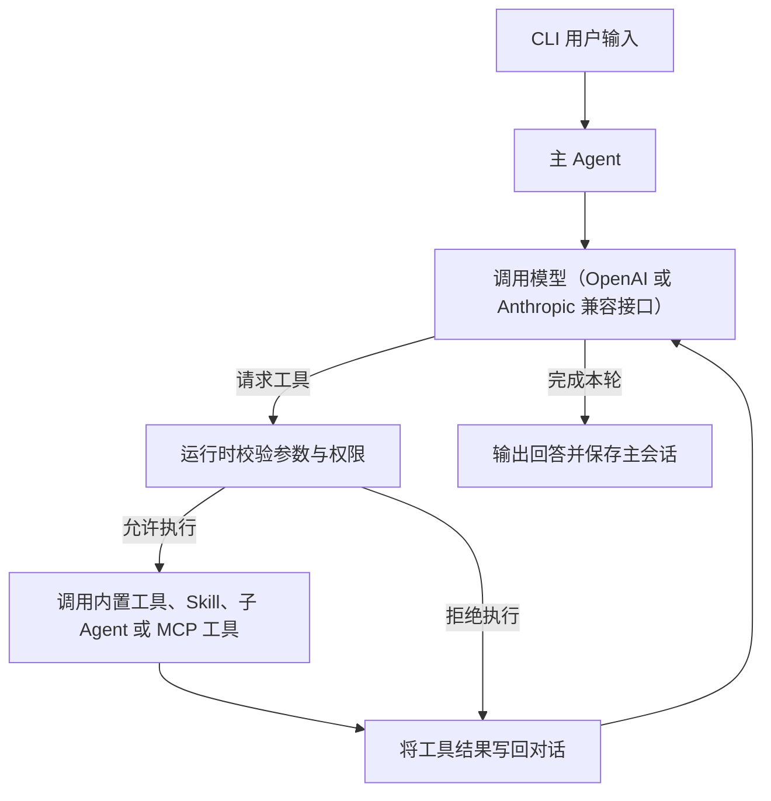

# ResearchAgent

ResearchAgent 是一个面向长程科研任务的 Python Agent 运行时。它提供本地命令行入口，适合分析研究代码仓库、梳理实验环境、执行脚本和排查失败原因。例如，给定一个待复现的仓库，可以先让 Agent 找出训练入口、数据路径和依赖，再根据生成的计划决定执行哪些命令。

## 核心亮点

- **通用 Agent Runtime**：统一编排模型、工具、权限、上下文、Memory、Skills 和外部扩展。
- **完整 Agent Loop**：模型请求、tool call 解析、权限检查、工具执行、tool result 回写、继续推理、会话保存形成闭环。
- **OpenAI / Anthropic 双协议**：支持 OpenAI-compatible 和 Anthropic-compatible 接口。
- **工具系统与权限控制**：支持读写文件、精确编辑、搜索、Shell、Skill 调用、子 Agent 和 MCP 工具；Plan Mode 下阻断写操作和 Shell。
- **Skills 体系**：通过项目级和用户级 `SKILL.md` 保存可复用方法，支持检索、调用、inline / fork 执行和版本化演化。
- **长期 Memory**：按项目路径 hash 隔离记忆，保存用户偏好、项目背景、历史决策和参考资料。
- **Skills 自进化**：从用户反馈中自动抽取可复用规则，新增或合并到 `SKILL.md`。
- **MCP 外部工具扩展**：通过官方 MCP Python SDK v2 的 stdio 会话接入外部 Server，把工具包装为 `mcp__server__tool`。
- **子 Agent**：支持 `explore`、`plan`、`general` 以及自定义子 Agent。
- **会话恢复和上下文压缩**：自动保存 session，支持 `--resume`、`/compact`，并对大工具结果做截断或持久化。

## 项目架构

`agents/main.py` 处理交互输入、一次性任务和会话恢复。主 Agent 在每轮对话中检索相关 Skills，可按需预取项目记忆。启用 MCP 时，主 Agent 会在首次对话时连接已配置的服务，并将发现的外部工具加入可用列表。[CLI 入口](agents/main.py) · [Agent 主循环](agents/agent.py) · [MCP 客户端](agents/mcp_client.py)



**长任务如何继续。** 模型可以主动调用 `compact_context`，运行时也会在上下文占用超过阈值时触发折叠。折叠后的事件记忆、工作记忆和工具记忆进入当前对话，供下一次推理使用。退出程序后，`--resume` 可以从磁盘恢复最近保存的会话。[折叠结构](agents/session_memory.py) · [会话存储](agents/session.py)

**反馈如何进入下一次任务。** 主 Agent 保留本轮任务和回复。收到下一轮输入后，后台流程可结合反馈提取候选经验，检索已有 Skill，决定新增、合并或丢弃。写入受权限控制，保存的 Skill 可在后续任务中被检索。[在线提取与维护](agents/online_skill_evolution.py) · [版本与来源记录](agents/skill_evolution.py)

## 目录结构

下面列出主要源码、测试和随项目交付的文件。

```text
ResearchAgent/
├── agents/
│   ├── main.py                    # CLI、参数解析、交互会话
│   ├── agent.py                   # 模型调用、工具分派、会话主循环
│   ├── prompt.py                  # 系统提示与项目规则
│   ├── tools.py                   # 内置工具、参数校验、权限检查
│   ├── mcp_client.py              # 通过 stdio 发现和调用外部工具
│   ├── subagent.py                # 子 Agent 角色与工具范围
│   ├── memory.py                  # 按项目保存和检索长期记忆
│   ├── session.py                 # 保存与恢复会话、写入折叠记录
│   ├── session_memory.py          # 构造、解析和格式化折叠记忆
│   ├── skills.py                  # Skill 发现、检索与调用
│   ├── online_skill_evolution.py  # 从反馈提取经验并决定如何更新 Skill
│   ├── skill_evolution.py         # Skill 文件、版本快照与来源记录
│   ├── online_skill_eval.py       # Skills 回放评测
│   ├── eval_folding.py            # 会话折叠的对照评测入口
│   ├── deepseek.py                # DeepSeek 专用请求配置与用量估算
│   ├── paths.py                   # 用户级及项目级存储共用的目录名
│   ├── frontmatter.py             # 解析 Markdown 文件头部元数据
│   └── ui.py                      # 终端输出与交互提示
├── tests/                         # 模型适配、折叠、权限、工具与 MCP 测试
│   └── fixtures/                  # 本地 MCP 测试服务和测试辅助代码
├── docs/                          # 设计方案、项目状态与验收记录
├── .mcp.json                      # 项目级 MCP 服务声明
├── .env.example                   # 模型接口与运行选项示例
├── requirements.txt               # Python 依赖
├── Dockerfile                     # CLI 容器构建入口
├── LICENSE
└── README.md
```

本地运行还会按需使用两个数据目录。用户主目录下的 `~/.research/sessions/` 保存可恢复的完整会话，`~/.research/projects/<hash>/memory/` 保存项目长期记忆。项目根目录下的 `.research/` 存放本地规则、Skills、子 Agent 定义、折叠与演化记录，整个目录由 Git 忽略。本地参考资料目录 `wiki/`、`notes/` 和 `paper/` 也由 Git 忽略。

## 在 WSL Ubuntu 中运行

项目使用 Python 3.11。已创建 `researchAgent` 环境的开发机可以直接运行以下命令。请在项目根目录执行。

```bash
conda activate researchAgent
python -m agents.main --help
```

首次配置开发机时，先创建环境并安装依赖。

```bash
conda create -n researchAgent python=3.11 pip -y
conda activate researchAgent
python -m pip install -r requirements.txt
python -m pip check
```

运行真实任务需要配置模型。在项目根目录的 `.env` 中填写服务商提供的密钥、接口地址和模型标识。以下是 OpenAI 兼容服务的配置示意，请替换尖括号中的值。[环境变量示例](.env.example)

```dotenv
OPENAI_API_KEY=<服务商提供的密钥>
OPENAI_BASE_URL=<服务商提供的兼容接口地址>
MODEL=<模型标识>
```

检查一个研究仓库时，可以从计划模式开始。后续进入交互模式后，可用 `/memory` 查看项目记忆，用 `/skills` 查看可调用的方法。

```bash
python -m agents.main --plan "阅读当前仓库，找出运行入口、依赖和测试命令，给出复现计划"
python -m agents.main --resume
```

## 本地配置与数据

用户设置、会话和项目记忆保存在 `~/.research/`。项目配置、Skills、规则、子 Agent 和折叠记录保存在项目的 `.research/` 下，由 Git 整体忽略。项目专用环境变量使用 `RESEARCH_` 前缀，例如 `RESEARCH_DEEPSEEK_THINKING`、`RESEARCH_AUTO_SKILL_EVOLUTION`。

## 当前重构重点

第一项改造是让 WSL 和 Linux 容器都能启动 MCP 工具。仓库目前为 Context7 和 Playwright 配置了 Windows 本机的 `npx.cmd` 绝对路径，Docker 镜像也会复制这份配置。改造的验收条件是在目标环境中通过项目客户端启动两个服务、列出工具，并在会话退出后回收子进程。[MCP 配置](.mcp.json) · [客户端](agents/mcp_client.py) · [Dockerfile](Dockerfile)

## 源码与测试

命令行入口在 [agents/main.py](agents/main.py)。理解长程任务如何继续执行，可从[会话折叠](agents/session_memory.py)和[会话保存](agents/session.py)读起。用户反馈如何变成可复用方法，见 [Skills 在线更新](agents/online_skill_evolution.py)和[版本与来源记录](agents/skill_evolution.py)。

在已激活的项目环境中运行离线测试：

```bash
python -s -B -m unittest discover -s tests -v
```

## 参考与许可

Agent 运行时的设计参考了开源项目 [claude-code-from-scratch](https://github.com/Windy3f3f3f3f/claude-code-from-scratch)。项目随附的 MIT 许可和版权声明见 [LICENSE](LICENSE)。
