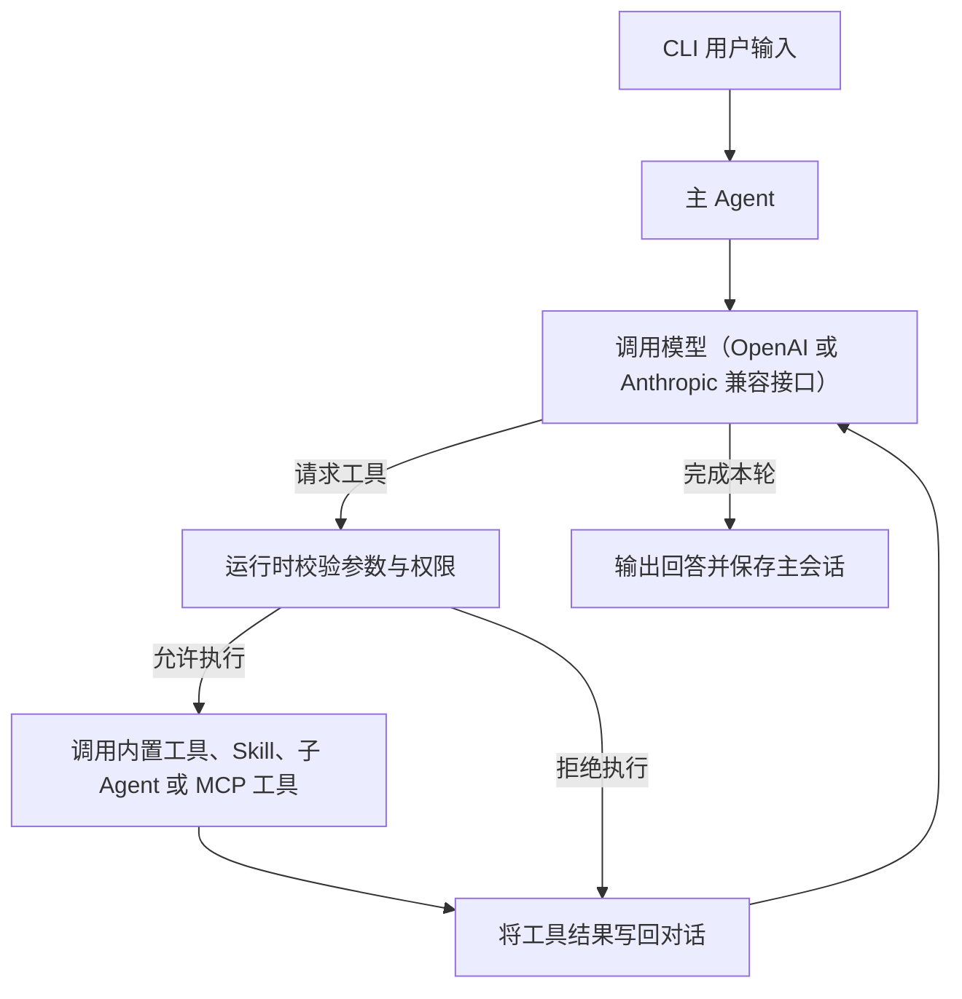

# ResearchAgent

ResearchAgent 是一个面向长程科研任务的 Python Agent 运行时。它提供命令行和本地浏览器会话入口，适合分析研究代码仓库、梳理实验环境、执行脚本和排查失败原因。例如，给定一个待复现的仓库，可以先让 Agent 找出训练入口、数据路径和依赖，再根据生成的计划决定执行哪些命令。

## 核心亮点

- **通用 Agent Runtime**：统一编排模型、工具、权限、上下文、Memory、Skills 和外部扩展。
- **完整 Agent Loop**：模型请求、tool call 解析、权限检查、工具执行、tool result 回写、继续推理、会话保存形成闭环。
- **OpenAI / Anthropic 双协议**：支持 OpenAI-compatible 和 Anthropic-compatible 接口。
- **工具系统与权限控制**：支持读写文件、精确编辑、搜索、Shell、Skill 调用、子 Agent 和 MCP 工具；Plan Mode 下阻断写操作和 Shell。
- **Skills 体系**：通过项目级和用户级 `SKILL.md` 保存可复用方法，支持检索、调用、inline / fork 执行和版本化演化。
- **长期 Memory**：按项目路径 hash 隔离记忆，保存用户偏好、项目背景、历史决策和参考资料。
- **Skills 自进化**：从用户反馈中自动抽取可复用规则，新增或合并到 `SKILL.md`。
- **MCP 外部工具扩展**：通过官方 MCP Python SDK v2 的 stdio 会话接入外部 Server，把工具包装为 `mcp__server__tool`。
- **子 Agent**：支持 `explore`、`plan`、`general` 以及自定义子 Agent。
- **会话恢复和上下文压缩**：自动保存 session，支持 `--resume`、`/compact`，并对大工具结果做截断或持久化。

## 项目架构

`agents/main.py` 处理交互输入、一次性任务和会话恢复。主 Agent 在每轮对话中检索相关 Skills，可按需预取项目记忆。启用 MCP 时，各角色在首次对话时连接获准的服务。默认由主 Agent 搜索和抓取静态页面，需要交互时可委派 explore 打开浏览器。[CLI 入口](agents/main.py) · [Agent 主循环](agents/agent.py) · [MCP 客户端](agents/mcp_client.py)



**长任务如何继续。** 模型可以主动调用 `compact_context`，运行时也会在上下文占用超过阈值时触发折叠。折叠后，下一次推理可看到事件记忆、工作记忆、工具记忆，以及近期完整问答和配对齐全的工具调用原文。尾部预算取有效窗口的 15% 与 12,000 token 中的较小值；最新完整交互单元超出预算时，只保留摘要。请求前触发折叠时，本轮待答问题仍按原文传入。退出程序后，`--resume` 按最后更新时间恢复当前项目、当前模型协议的最近会话，并沿用原会话 ID。[折叠结构](agents/session_memory.py) · [会话存储](agents/session.py)

**反馈如何进入下一次任务。** 主 Agent 保留本轮任务和回复。收到下一轮输入后，后台流程可结合反馈提取候选经验，检索已有 Skill，决定新增、合并或丢弃。写入受权限控制，保存的 Skill 可在后续任务中被检索。[在线提取与维护](agents/online_skill_evolution.py) · [版本与来源记录](agents/skill_evolution.py)

## 目录结构

下面列出主要源码、测试和随项目交付的文件。

```text
ResearchAgent/
├── agents/
│   ├── main.py                    # CLI、参数解析、交互会话
│   ├── agent.py                   # 模型调用、工具分派、会话主循环
│   ├── prompt.py                  # 系统提示与项目规则
│   ├── tools.py                   # 内置工具、参数校验、权限检查
│   ├── mcp_client.py              # 通过 stdio 发现和调用外部工具
│   ├── subagent.py                # 子 Agent 角色与工具范围
│   ├── memory.py                  # 按项目保存和检索长期记忆
│   ├── session.py                 # 保存与恢复会话、写入折叠记录
│   ├── session_memory.py          # 构造、解析和格式化折叠记忆
│   ├── skills.py                  # Skill 发现、检索与调用
│   ├── online_skill_evolution.py  # 从反馈提取经验并决定如何更新 Skill
│   ├── skill_evolution.py         # Skill 文件、版本快照与来源记录
│   ├── online_skill_eval.py       # Skills 回放评测
│   ├── eval_folding.py            # 会话折叠的对照评测入口
│   ├── deepseek.py                # DeepSeek 专用请求配置与用量估算
│   ├── paths.py                   # 用户级及项目级存储共用的目录名
│   ├── frontmatter.py             # 解析 Markdown 文件头部元数据
│   └── ui.py                      # 终端输出与交互提示
├── tests/                         # 模型适配、折叠、权限、工具与 MCP 测试
│   └── fixtures/                  # 本地 MCP 测试服务和测试辅助代码
├── docs/                          # 设计方案、项目状态与验收记录
├── .mcp.json                      # 项目级 MCP 服务声明
├── .env.example                   # 模型接口与运行选项示例
├── requirements.txt               # Python 依赖
├── Dockerfile                     # CLI 容器构建入口
├── LICENSE
└── README.md
```

本地运行还会按需使用两个数据目录。用户主目录下的 `~/.research/sessions/<session_id>.json` 保存用于恢复的当前上下文快照，同目录的 `<session_id>.events.jsonl` 按发生顺序追加用户输入、模型响应、工具结果、压缩、折叠和恢复事件。折叠前的记录可以按 `seq` 回查；超过 30 KiB 的工具结果可通过事件中的 `artifact_path` 找到原件。项目长期记忆保存在 `~/.research/projects/<hash>/memory/`。项目根目录下的 `.research/` 存放本地规则、Skills、子 Agent 定义、折叠与演化记录，整个目录由 Git 忽略。本地参考资料目录 `wiki/`、`notes/` 和 `paper/` 也由 Git 忽略。

## 在 WSL Ubuntu 中运行

项目使用 Python 3.11。已创建 `researchAgent` 环境的开发机可以直接运行以下命令。请在项目根目录执行。

```bash
conda activate researchAgent
python -m agents.main --help
```

首次配置开发机时，先创建环境并安装依赖。

```bash
conda create -n researchAgent python=3.11 pip -y
conda activate researchAgent
python -m pip install -r requirements.txt
python -m pip check
```

运行真实任务需要配置模型。在项目根目录的 `.env` 中填写服务商提供的密钥、接口地址和模型标识。以下是 OpenAI 兼容服务的配置示意，请替换尖括号中的值。[环境变量示例](.env.example)

```dotenv
OPENAI_API_KEY=<服务商提供的密钥>
OPENAI_BASE_URL=<服务商提供的兼容接口地址>
MODEL=<模型标识>
```

检查一个研究仓库时，可以从计划模式开始。后续进入交互模式后，可用 `/memory` 查看项目记忆，用 `/skills` 查看可调用的方法。单独输入 `/` 可查看命令帮助。CLI 按完整命令名匹配，遇到未知命令会立即提示并等待下一次输入。以多段路径（如 `/tmp/test.log 帮我分析报错`）或斜杠加空格（如 `/ 请帮我查一下`）开头的消息按普通聊天处理。

```bash
python -m agents.main --plan "阅读当前仓库，找出运行入口、依赖和测试命令，给出复现计划"
python -m agents.main --resume
```

用 `python -m agents.main --resume <session_id>` 可指定快照，ID 取自 `~/.research/sessions/<session_id>.json` 的文件名。旧版快照需要显式指定 ID，CLI 会给出兼容提示；下次保存时写入新版元数据。路径审批和 Web 缓存在新进程中重新建立。要在最近会话中执行一次性任务，可用 `python -m agents.main --resume -- "继续上次的分析"`。

## 在任意项目目录启动

在 Python 3.11 环境中，从 ResearchAgent 源码根目录运行一次 `python -m pip install .`。开发时可用 `python -m pip install -e .`。新终端激活安装时的环境，确保该环境的可执行文件目录在 `PATH` 中。

在 `~/.researchagent/.env` 配置模型凭据和模型名，可沿用上面的变量示例。安装版先读取进程环境，再读取启动目录的 `.env`，最后补充全局配置。同类凭据和接口地址的别名遵循同一顺序。启动目录决定项目规则、相对文件路径和 Shell 工作目录。

```bash
cd /你的/项目目录
researchagent
researchagent "梳理这个项目的目录结构"
researchagent -p "列出项目的测试入口"
```

带任务启动会在首轮回答后继续接受追问。`-p` 或 `--print` 在本轮结束后退出。`python -m agents.main "任务"` 继续按一次性任务执行。

从同一目录继续工作时，用 `researchagent -c` 恢复当前目录与模型协议下最近更新的会话，用 `researchagent -r` 按编号选择。列表显示本地时间、会话 ID 和任务预览。空回车、`q` 或 Ctrl+C 取消选择。

```bash
researchagent -c -p "接着整理上一次的结果"
researchagent --resume SESSION_ID -p "继续分析"
```

`-c` 找不到匹配会话时返回非零；`-r` 的空列表或取消返回零。`-r` 需要终端选择，与 `-p` 互斥。旧快照可用 `--resume SESSION_ID` 显式恢复。

## 本地 Web 会话

在已配置模型的工作区启动服务。默认地址为 `http://127.0.0.1:8765/`，可用 `--port` 指定其他端口。

```bash
python -m pip install -r requirements.txt
python -m agents.web
```

打开页面，输入任务并选择「发送任务」。同一页面的后续消息沿用当前 Agent 的会话历史。模型输出逐段显示；工具需要授权时，审批卡会展示运行时提供的请求信息。选择「批准」或「拒绝」后，模型会收到对应结果并继续任务。文件与命令以启动服务的目录为工作区，权限规则与默认 CLI 模式一致。刷新页面会建立新会话。服务仅监听本机回环地址，密钥由服务端从环境或 `.env` 加载。

每轮任务结束后，展开该轮的「工具追踪」可查看主 Agent 与子 Agent 的工具调用树。耗时条按本轮最慢的单次调用缩放；父调用的耗时包含子调用。点击工具名可查看开始时间、Span ID、父 Span ID、工具来源、执行状态和输出字符数。「联网只读工具缓存命中」以已执行的 `web_search` 和 `web_fetch` 次数为分母。服务端读取本轮的 `~/.research/traces/<trace_id>.jsonl`；同一页面可分别展开此前各轮的记录。

每个标签页独立计算空闲时间。等待下一条任务或等待用户审批超过 15 分钟，服务端会关闭该连接、取消未处理的审批，并释放该会话的 MCP 和浏览器资源。正在执行的工具和模型请求可继续运行。页面显示空闲关闭后，刷新可开始新会话。

可以在启动时调整等待时间，单位为秒。例如将空闲期限设为 5 分钟：

```bash
python -m agents.web --idle-timeout 300
```

## 本地配置与数据

用户设置、会话和项目记忆保存在 `~/.research/`。项目配置、Skills、规则、子 Agent 和折叠记录保存在项目的 `.research/` 下，由 Git 整体忽略。项目专用环境变量使用 `RESEARCH_` 前缀，例如 `RESEARCH_DEEPSEEK_THINKING`、`RESEARCH_AUTO_SKILL_EVOLUTION`。

## 联网查询

已有 URL 时，`web_fetch` 通过 HTTP 获取静态正文，无需搜索密钥。查找未知来源时，`web_search` 默认使用 Tavily。在项目根目录 `.env` 中配置 `TAVILY_API_KEY` 即可；使用 Serper 时设置 `RESEARCH_SEARCH_PROVIDER=serper` 和 `SERPER_API_KEY`。一次查询只使用选定的服务商。搜索正文和抓取结果以外部数据标记传入模型。[环境变量示例](.env.example)

主 Agent 和 `explore` 子 Agent 共享当前会话的成功搜索、抓取结果，TTL 为 30 分钟。Trace 的 `cache_hit` 可区分复用与实际请求。浏览器操作每次执行。遇到需要点击或动态渲染的页面，主 Agent 可以把 URL 与要核实的问题交给 `explore`。

`web_search` 把显示的候选项写入当前项目的 `.research/artifacts/<session_id>/candidates.jsonl`。主 Agent 可用 `update_candidate_status(canonical_id, status, reason)` 把条目标为 `candidate`、`selected` 或 `rejected`，用 `list_candidates(status?)` 查看对应条目和完整理由。再次命中时，搜索结果会附上当前状态和理由预览，已淘汰条目仍可重新选择。即使命中搜索缓存，状态也从当前会话的账本读取。用 `--resume` 恢复原会话后可以继续筛选。

## MCP 启动与工具日志

先在运行 CLI 的环境中安装 Node.js，确认 `node` 和 `npx` 均在 PATH 上。WSL 使用 Linux 的 Node.js。项目配置通过 PATH 解析 Context7 和 Playwright 的启动命令。Playwright MCP 固定为 `0.0.86`，使用独立的无头 Chromium，并关闭图片回传。首次运行前，可在同一用户环境中安装配套浏览器和 Linux 运行库。

```bash
npm exec --yes --package=@playwright/mcp@0.0.86 -- playwright install --with-deps chromium
```

默认配置仅为 `explore` 启动 Playwright，并开放 8 个导航、快照与交互工具。每个 MCP 服务可配置 `roles` 和 `allowed_tools`。省略 `roles` 的旧声明仍归主 Agent；`roles: []` 关闭该服务的自动挂载。仓库的 Context7 配置保留为可选项，如需原有用法可将其 `roles` 改为 `["main"]`。服务名须非空且不含 `__`。连接就绪限时 20 秒，初始化和工具发现各限时 15 秒。退出时，清理超过 15 秒会告警，达到 30 秒时报告超时。服务自身的诊断输出追加到 `~/.research/logs/mcp-<服务名>.stderr.log`。

每轮对话实际执行的工具调用记录在 `~/.research/traces/<trace_id>.jsonl`。每行包含工具、角色、耗时、输出字符数及成功或失败状态，子 Agent 调用通过父 span 关联。参数校验和审批在执行前完成，读取工具调用次数时按执行记录计数。超过 30 KiB 的结果仍走原有落盘流程。[MCP 配置](.mcp.json) · [P0/P1 验收记录](<docs/02-验收记录/003-ResearchAgent 联网能力与 MCP 演进.md>)

需要保存一次任务的完整工具结果时，可在启动 CLI 前设置 `RESEARCH_TOOL_MODE=record`。快照位于 `~/.research/snapshots/<trace_id>/<span_id>.json`，包含工具名、规范化参数和完整返回内容；同一工具多次调用分别保存。默认模式为 `live`。录制文件可能包含查询内容和本地文件正文，请按原始数据的访问权限保管。

单次工具回放使用 `RESEARCH_TOOL_MODE=replay`，并用 `RESEARCH_TOOL_SNAPSHOT` 指定录制所得的一个 JSON 文件，例如 `~/.research/snapshots/<trace_id>/<span_id>.json`。新会话中的工具名和规范化参数匹配时，直接返回该次录制的正文、错误标志及元数据。快照缺失或参数不匹配时返回工具错误，回放路径不会访问上游或读写联网工具缓存。此模式只回放单次工具结果，启动常规 CLI 对话仍会调用模型。

## 源码与测试

命令行入口在 [agents/main.py](agents/main.py)。理解长程任务如何继续执行，可从[会话折叠](agents/session_memory.py)和[会话保存](agents/session.py)读起。用户反馈如何变成可复用方法，见 [Skills 在线更新](agents/online_skill_evolution.py)和[版本与来源记录](agents/skill_evolution.py)。

在已激活的项目环境中运行离线测试：

```bash
python -s -B -m unittest discover -s tests -v
```

## 参考与许可

Agent 运行时的设计参考了开源项目 [claude-code-from-scratch](https://github.com/Windy3f3f3f3f/claude-code-from-scratch)。项目随附的 MIT 许可和版权声明见 [LICENSE](LICENSE)。
